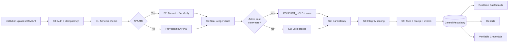

# APAAR-Pramaan
### National Student Identity & Seat Integrity Platform for AICTE

> *From counting students to knowing them — every seat controlled, every student verified, every record provable.*

[](LICENSE)
[](https://www.typescriptlang.org/)
[](https://www.python.org/)
[](https://fastapi.tiangolo.com/)
[](https://react.dev/)
[](https://www.postgresql.org/)

<div align="center">
  
**[Live Demo](http://localhost:5173)** • **[API Docs](http://localhost:8000/docs)** • **[Architecture](#architecture)** • **[Quick Start](#quick-start)**

</div>

---

## Table of Contents

1. [Overview](#overview)
2. [The Problem](#the-problem)
3. [Our Solution](#our-solution)
4. [Key Innovations](#key-innovations)
5. [Architecture](#architecture)
6. [Tech Stack](#tech-stack)
7. [Quick Start](#quick-start)
8. [Features](#features)
9. [Dashboards](#dashboards)
10. [Security & Privacy](#security--privacy)
11. [API Reference](#api-reference)
12. [Deployment](#deployment)
13. [Contributing](#contributing)
14. [License](#license)

---

## Overview

**APAAR-Pramaan** (*pramaan* = proof in Hindi) is a national trust infrastructure that transforms AICTE's student headcounts into a living, verifiable student ledger. Built on the APAAR (Automated Permanent Academic Account Registry) identity foundation, it makes every seat a controlled resource, every student a verified identity, every claim provable, and every decision traceable — **with humans always in charge**.

### What Makes This Different

| Traditional System | APAAR-Pramaan |
|---|---|
| Count and compare (post-hoc) | **Prevention-first** — breaches detected the instant data arrives |
| "Trust but don't verify" | **Trust Ladder** — every record shows *how well it is proven* (L0–L4) |
| Aggregate headcounts | **Identity-first** — person-centric ledger with verifiable credentials |
| Manual duplicate detection | **Database-enforced Single-Seat Lock** — impossible to bypass by concurrency |
| Static reports | **Real-time dashboards** with live seat meters and case alerts |
| Opaque decisions | **Explainable integrity engine** — every finding has reason codes and arithmetic |

### One-Paragraph Pitch

*APAAR-Pramaan converts AICTE's aggregate headcounts into a living, verifiable student ledger. A Seat Ledger guards every approved seat, a database-enforced Single-Seat Lock stops double enrolment across institutions, a Trust Ladder separates claimed from proven data, an explainable integrity engine tells officers where to look first, and a signed, consent-based QR lets an employer verify a degree in seconds without seeing a student's private data. Built API-first, privacy-by-design and tamper-evident, it gives AICTE authentic data for governance while keeping humans in charge of every regulatory decision.*

---

## The Problem

AICTE today knows **how many** students an institution *claims* to have. For most non-PGDM institutions it does not know **who** they are. This blocks:

- ❌ **Excess admission detection** — breaches found a year later, not at upload
- ❌ **Duplicate enrolment prevention** — same student claiming multiple seats
- ❌ **Trustworthy verification** — employers cannot verify degrees without calling institutions
- ❌ **Evidence-based policy** — decisions based on aggregate counts, not verified identities
- ❌ **Fair accountability** — institutions blamed for breaches due to timing luck, not actual overflow

### The Flight Analogy

| Flight (180 seats) | Current AICTE | APAAR-Pramaan |
|---|---|---|
| **Seat map** | Aggregate count | Double-entry seat ledger per pool |
| **Boarding check** | Optional | APAAR/identity verification (with provisional path) |
| **One seat per passenger** | No enforcement | Database-enforced Single-Seat Lock |
| **Gate counter** | Manual reconciliation | Atomic claim counter with overflow detection |
| **Crew alert** | Post-flight audit | Real-time integrity engine with ranked queue |
| **E-ticket QR** | No credential | Signed, consent-based verifiable credential |
| **Black box** | Paper trail | Hash-chained, tamper-evident audit with Time Machine |

---

## Our Solution

### The Platform Does 10 Things

| # | Capability | Value |
|---|---|---|
| 1 | **Seat Ledger (Seat-Gate)** | Double-entry seat accounting per programme-year-pool; breaches detected instantly |
| 2 | **Single-Seat Lock** | One person, one active full-time seat — enforced *inside the database* |
| 3 | **Pramaan Identity Graph** | APAAR-first, inclusive of FN/OCI/NRI via provisional identity; reversible merges |
| 4 | **Trust Ladder** | Every record shows *how well proven* (L0–L4); dashboards report verified share |
| 5 | **Integrity Engine** | Rules + stats + ML, explainable, shadow-tested; ranked scrutiny queue |
| 6 | **Signed Receipts + Evidence Packs** | Institutions get signed proof; officers get exportable case dossiers |
| 7 | **Verifiable Credentials** | Static certificate QR + rotating wallet QR, consent handshake, instant revocation |
| 8 | **Time Machine** | Bitemporal history: "what did AICTE know on date X?" |
| 9 | **Tamper-evident Audit** | Hash-chained, crypto-shreddable for DPDP compliance |
| 10 | **Policy-as-Code Studio** | Versioned rules with dry-run, back-test and staged enforcement |

---

## Key Innovations

### 14 Ideas That Make This Different

<details>
<summary><b>I-1: Seat Ledger — Double-Entry Seat Accounting</b></summary>

**Problem:** "Count and compare" is racy, order-dependent and blames the wrong student.

**Solution:** Each programme-year has seat pools (REGULAR, NRI, OCI, FN, SUPERNUMERARY) arranged in a tree. Every admission is a claim with a monotonic `slot_no`. `over_by = max(0, claimed − cap)` is a property of the *pool*, so the breach case attaches to the ledger, not the 61st student.

**Shown in:** Command Centre radar, Institution Console seats-remaining meter, 1,000-concurrent demo.
</details>

<details>
<summary><b>I-2: Single-Seat Lock with Privacy-Preserving Conflict Mediation</b></summary>

**Mechanism:** Partial unique index makes two active full-time enrolments *impossible*. The losing claim is `CONFLICT_HOLD` with a case opened. Each institution sees "active enrolment elsewhere" — the other institution's identity revealed only to AICTE officer.

**Privacy twist:** Avoids institution poaching or harassment.
</details>

<details>
<summary><b>I-3: Pramaan Identity Graph with Reversible Merges</b></summary>

Random `person_id`; aliases (APAAR, PPID, passport ref) attach to it. Fuzzy match proposes; humans confirm low-confidence merges; every merge journaled and reversible.
</details>

<details>
<summary><b>I-4: Trust Ladder as Computed Projection ★</b></summary>

Trust level derived from `trust_evidence` table (format check, APAAR response, officer verification, lock/seat pass). Critical case demotes automatically; closure restores. Reports show **trust-weighted** enrolment.

| Level | Name | Proof |
|---|---|---|
| L0 | Claimed | Record received |
| L1 | Format-valid | Format checks pass |
| L2 | ID-Verified | APAAR verified OR officer doc-verified (FN/OCI/NRI) |
| L3 | Cross-checked | L2 + seat pass + lock pass + no critical case |
| L4 | AICTE-certified | L3 + institution affirmed + officer certification |
</details>

<details>
<summary><b>I-5: Signed Submission Receipts ★</b></summary>

Every batch yields AICTE-signed receipt (batch hash, counts, policy version, timestamp). Institution proves *what it submitted*; AICTE proves *what it received*. Ends "we never sent / you never received" disputes.
</details>

<details>
<summary><b>I-6: Time Machine (Bitemporal History) ★</b></summary>

Events carry `effective_at` (when true) and `recorded_at` (when AICTE learned it). Any dashboard accepts `?as_of=` — officers can ask "what did we know on 30 Sept?" Essential for audits, appeals, fair back-dated rules.
</details>

<details>
<summary><b>I-7: Explainable Integrity Engine with Shadow Mode</b></summary>

Rules (precision) + statistics/ML/graph (recall). New rules run in **shadow** (scored, not surfaced) and promoted only after measured precision on reviewed cases. Scores cohort-relative with minimum-sample guard.
</details>

<details>
<summary><b>I-8: Declared-vs-Derived Reconciliation ★</b></summary>

Institutions *declare* headline numbers (intake, enrolment, NRI, OCI, FN). Platform *derives* from student rows. **The delta is a finding** — catches reporting lag and ghost students.
</details>

<details>
<summary><b>I-9: Dual-QR Credentials with Consent Handshake ★</b></summary>

- **Static certificate QR** (printed on degrees): public, minimal ("Valid/Revoked, degree, year, institution")
- **Rotating wallet QR** (student's phone): short-lived token bound to device key; screenshots expire
- **Pramaan Handshake:** Employer shows request QR (purpose + fields) → student approves → employer receives minimal result. Verifiers cannot look up by APAAR ID.
</details>

<details>
<summary><b>I-10: Crypto-Shreddable, Tamper-Evident Audit ★</b></summary>

Audit events contain **salted digests**, not PII. PII payload encrypted under per-subject key. Deleting key (DPDP erasure) keeps chain verifiable while data unreadable. Chains sharded; daily **Merkle root** externally timestamped.
</details>

<details>
<summary><b>I-11: Evidence Packs and SLA Clocks ★</b></summary>

Every case exports **signed Evidence Pack** (arithmetic, records, rule versions, timeline, hashes). Cases carry SLA clocks, ageing, escalation. Institutions get appeal rights recorded.
</details>

<details>
<summary><b>I-12: Policy-as-Code Studio with Back-Testing ★</b></summary>

Policy lives as versioned JSON/YAML. Before release: **dry-run** on last year's data, **diff** of newly flagged, staged **runway**: *Observe → Warn → Soft → Hard* per rule per cohort. Policy Simulator is the visual front-end.
</details>

<details>
<summary><b>I-13: Pre-flight Dry Run with Seat Forecast ★</b></summary>

Institutions upload in `dry_run` mode: row errors, projected seat consumption, likely conflicts and trust mix returned **without committing**. Compliance becomes self-service.
</details>

<details>
<summary><b>I-14: Fair Institution Integrity Index</b></summary>

Cohort-relative, confidence-banded, explainable, appealable and **never used for automatic action**. Exists to prioritise attention and give institutions a visible, improvable number.
</details>

---

## Architecture

### System Overview

```
┌────────────────── EXPERIENCE LAYER ───────────────────┐
│ 9 Role-Based Dashboards (React + TypeScript + Vite)   │
│ • AICTE Command Centre • Scrutiny Workbench           │
│ • Policy Studio • Institution Console                 │
│ • Student Wallet • Verifier Portal                    │
│ • Integrity & Audit • Integration Hub                 │
│ • Certificate Issuer Console                          │
└───────────────────────┬───────────────────────────────┘
                        │ HTTPS + SSE/WebSocket
┌───────────────────────▼───────────────────────────────┐
│ EDGE: API Gateway + Keycloak (OIDC/MFA) + Rate Limits │
└───────────────────────┬───────────────────────────────┘
                        │
┌───────────────────────▼───────────────────────────────┐
│     PRAMAAN CORE (FastAPI modular monolith)           │
│                                                        │
│ ingest │ identity │ seats │ lock │ lifecycle │        │
│ integrity │ cases │ policy │ credentials │ consent │  │
│ verification │ analytics │ audit │ admin              │
│                                                        │
│ Each module = api · domain · repository · events      │
└──────┬─────────────────┬──────────────────────────────┘
       │ ACID            │ Transactional Outbox
┌──────▼──────┐   ┌──────▼──────────────┐
│ PostgreSQL  │   │ Event Bus (Outbox)  │
│ (authority: │   │ MVP: LISTEN/NOTIFY  │
│ seats,lock, │   │ Scale: Kafka        │
│ identity,   │   └──────┬──────────────┘
│ audit)      │          │
└──────┬──────┘   ┌──────▼──────────────┐
       │          │ Workers (ML,        │
       │          │ reports, rollups)   │
┌──────▼──────┐   └─────────────────────┘
│ MinIO       │
│ (files,     │
│ evidence)   │
└─────────────┘

┌─────── ADAPTER LAYER (ports & adapters) ──────┐
│ ApaarVerifier (MOCK → Real APAAR/DigiLocker)  │
│ ApprovalMaster │ InstitutionERP │ Notifier    │
│ Signer (Ed25519 → HSM) │ TimestampAuthority   │
└────────────────────────────────────────────────┘
```

### Why a Modular Monolith?

- **One deployable, one transaction boundary** → seat claims, locks, cases and audit commit atomically
- **Transactional outbox:** every state change writes outbox row in same transaction; relay publishes to bus
- **Boundaries enforced:** import-linter fails build if modules cross-access tables
- **Extraction-ready:** when a module needs independent scaling, extract along clean seam

### Data Flow



---

## Tech Stack

### Why This Stack Wins

| Decision | Reason |
|---|---|
| **One Database (PostgreSQL)** | Seat Ledger, Single-Seat Lock, row-level security, fuzzy search, JSONB — one transaction boundary |
| **Python + FastAPI** | Backend and ML share language; async; auto OpenAPI docs |
| **React + TypeScript** | Nine dashboards; largest ecosystem; TypeScript catches bugs early |
| **Modular Monolith** | Small team builds fast; boundaries clean; split later if needed |
| **Keycloak** | Auth is risky to build; Keycloak gives OIDC, MFA, roles free |
| **Mock Adapters** | Cannot call real APAAR in hackathon; adapters swap later |
| **Docker Compose** | One command runs everything |
| **100% Open Source** | Zero licence cost; government adoption friendly |

### Complete Stack

| Layer | Technology |
|---|---|
| **Frontend** | React 18 + TypeScript 5.6 + Vite, Tailwind CSS + shadcn/ui, Recharts, Leaflet, TanStack Query |
| **Student/Verifier** | PWA + html5-qrcode (camera scan) |
| **Backend** | Python 3.12 + FastAPI 0.115 + Pydantic v2 |
| **Database** | PostgreSQL 16 (RLS, partial indexes, pg_trgm, advisory locks) |
| **ORM** | SQLAlchemy 2 + psycopg3, Alembic (migrations) |
| **Workers** | Postgres job table (FOR UPDATE SKIP LOCKED) → Celery/RQ later |
| **Events** | Transactional outbox + LISTEN/NOTIFY → Kafka/Redpanda later |
| **Cache** | Redis (optional, cache/rate-limit only — never seat counts) |
| **Storage** | MinIO (S3-compatible, local) |
| **Auth** | Keycloak (OIDC, MFA/TOTP) |
| **Crypto** | cryptography lib (Ed25519, AES-GCM, HMAC), SD-JWT, qrcode |
| **ML** | pandas, scikit-learn, PyOD, statsmodels, SHAP, NetworkX |
| **Reports** | Pandas + WeasyPrint (PDF) + openpyxl (Excel) |
| **Testing** | pytest, Hypothesis, Playwright, k6 |
| **CI/CD** | GitHub Actions, Trivy, OWASP ZAP, Ruff, mypy |
| **Containers** | Docker + Docker Compose (MVP) → Kubernetes (Scale) |

---

## Quick Start

### Prerequisites

- Docker Desktop (Windows/Mac) or Docker Engine (Linux)
- Node.js 18+ and npm
- Python 3.12+ (for local development)
- Git

### One-Command Startup

```powershell
# Clone the repository
git clone https://github.com/KrishnaRajput07/Apaar.git
cd Apaar/apaar-pramaan

# Start everything (backend + frontend)
powershell -ExecutionPolicy Bypass -File start-dev.ps1
```

This script:
1. Starts Docker services (PostgreSQL, Redis, FastAPI, Mock APAAR)
2. Seeds the database with demo data
3. Launches the Vite dev server

### Manual Startup

```bash
# 1. Start backend services
docker compose up -d db redis api apaar-mock

# 2. Wait for database health check (5-10 seconds)
docker compose ps

# 3. Seed the database
docker compose exec api python -m app.seed

# 4. Start frontend
npm install
npm run dev
```

### Access Points

| Service | URL | Credentials |
|---|---|---|
| **Frontend** | http://localhost:5173 | See below |
| **API Docs** | http://localhost:8000/docs | - |
| **Mock APAAR** | http://localhost:8001/docs | - |

### Demo Login Credentials

| Role | Email | Password |
|---|---|---|
| **Student** | arjun@demo.edu | demo1234 |
| **Institution** | admin@demo.edu | demo1234 |
| **AICTE Officer** | officer@aicte.gov | demo1234 |

---

## Features

### For AICTE Officers

✅ **Real-time Command Centre** — national seat utilisation, breach alerts, trust distribution  
✅ **Scrutiny Workbench** — ranked case queue with SLA clocks, explainable findings  
✅ **Policy Studio** — slider-based rule editor with back-testing and staged runway  
✅ **Integrity Dashboard** — audit chain health, tamper detection, Time Machine queries  
✅ **Identity Graph** — provisional identities, merge proposals, duplicate resolution  
✅ **Analytics** — regional heatmaps, trend charts, cohort comparisons  
✅ **Verifier Registry** — manage employer verifiers, quota, access logs  

### For Institutions

✅ **Institution Console** — seats remaining meters, submission history, case alerts  
✅ **Batch Upload** — CSV/API with dry-run, row-level errors, idempotency, signed receipts  
✅ **Student Management** — search, filter, trust-level view, document verification  
✅ **Case Responses** — view findings, upload evidence, track SLA, appeal decisions  
✅ **Declared-vs-Derived** — reconciliation dashboard with gap analysis  
✅ **Integration Hub** — REST API, webhooks, ERP connectors, sample code  

### For Students

✅ **Student Wallet** — verifiable credentials with rotating QR, consent management  
✅ **Privacy Centre** — access log (who verified what, when), revocation controls  
✅ **Document Upload** — live photo verification, file preview, progress tracking  
✅ **Verification Requests** — consent handshake, field selection, device-bound approval  

### For Employers/Verifiers

✅ **Verifier Portal** — scan QR, view minimal result (Valid/Revoked/Expired)  
✅ **Consent-Based Access** — request-specific fields, student approves, time-limited  
✅ **Verification History** — audit log, quota tracking, anti-abuse controls  
✅ **API Integration** — programmatic verification with rate limits  

---

## Dashboards

### D1: AICTE Command Centre

**Who:** AICTE National / Regional Officers  
**Purpose:** National real-time oversight

**Key Tiles:**
- Enrolment radar (actual vs approved by region)
- Seats remaining meter (live countdown)
- Trust distribution (L0–L4 mix)
- Open cases by severity (HIGH/CRITICAL first)
- Institution integrity bands (A–E distribution)
- Top breaches list (institutions over cap)
- Trend charts (enrolment vs verification over time)

**Live Updates:** SSE streams seat claims, case opens, trust promotions

### D2: Scrutiny Workbench

**Who:** AICTE Officers reviewing cases  
**Purpose:** Ranked case queue with evidence

**Features:**
- SLA-sorted list (due today, ageing, escalated)
- Filter by type, severity, institution, region
- Explainable findings (reason codes, arithmetic, rule versions)
- Evidence pack viewer (records, timeline, hashes)
- One-click decision recording (outcome + rationale)
- Feedback labels (USEFUL / FALSE_POSITIVE / NEEDS_INFO)

**Innovations:**
- **Cohort-relative scoring** — small institutions not noisy
- **Shadow-mode rules** — new rules scored silently before surfacing
- **Appeal workflow** — institution responses, second-level review

### D3: Policy Studio

**Who:** AICTE Policy Team  
**Purpose:** Rule versioning, back-testing, staged enforcement

**Features:**
- Visual rule editor (caps, windows, exceptions as JSON/YAML)
- Dry-run simulator (last year's data → who gets flagged)
- Diff report (newly flagged / un-flagged institutions)
- Compliance runway slider (Observe → Warn → Soft → Hard)
- Back-test comparison (policy v6 vs v7 on same cohort)
- Approval workflow (change notes, approval signatures)

**Use Case:** Before releasing policy v8, run back-test on 2025-26 data, see 12 newly flagged institutions, decide whether to proceed or adjust caps.

### D4: Institution Console

**Who:** Institution Admin  
**Purpose:** Self-service compliance, submission tracking

**Key Sections:**
- Seats remaining (live meters per pool)
- Submission history (batches, receipts, error reports)
- Student list (search, filter by trust level, hold state)
- Open cases (view findings, upload evidence, track SLA)
- Declared-vs-Derived reconciliation (gap analysis)
- Integration status (API health, last sync)

**Innovations:**
- **Pre-flight dry-run** — upload in test mode, see projected breaches before commit
- **Signed receipts** — downloadable proof of what was submitted
- **Seat forecast** — "you have 12 REGULAR seats; this batch claims 15 → will breach"

### D5: Student Wallet & Privacy Centre

**Who:** Students  
**Purpose:** Credential management, consent control, privacy transparency

**Features:**
- Rotating wallet QR (60-second expiry, device-bound)
- Static certificate QR (printed on degree, public info only)
- Access log (who verified, when, what fields, outcome)
- Revocation controls (instant, retroactive denial)
- Verification request inbox (employer asks → student approves/denies)
- Trust level display (L0–L4 badge with explanation)

**Privacy Guarantees:**
- Employer cannot enumerate by APAAR ID
- Student sees every access attempt
- Revoked credentials show "REVOKED" on next scan, no stale state

### D6: Verifier Portal

**Who:** Employers, Regulators  
**Purpose:** Consent-based verification

**Flow:**
1. Create verification request (purpose + fields)
2. Generate request QR
3. Student scans, reviews, approves/denies
4. Verifier receives minimal result: Valid, degree, year, institution (only consented fields)

**Features:**
- QR scanner (PWA camera)
- Verification history (audit log, quota tracking)
- API key management (for programmatic verification)
- Anti-abuse controls (rate limits, daily quota, purpose validation)

### D7: Integrity & Audit Dashboard

**Who:** AICTE Officers, Auditors  
**Purpose:** Tamper detection, chain health, Time Machine

**Key Panels:**
- Audit chain health (all chains valid / tampered)
- Nightly invariant status (seat ledger drift check)
- Time Machine query (`?as_of=2026-09-30` → historical state)
- Merkle root verification (external timestamp, WORM anchor)
- Crypto-shredding status (DPDP erasure without breaking chain)

**Demo Moment:**
- Manually edit a student row via SQL → integrity checker turns red → specific event flagged

### D8: Integration & Data-Quality Hub

**Who:** Institution IT Teams  
**Purpose:** API integration, ERP connectors, data quality

**Sections:**
- REST API docs (OpenAPI spec, code samples)
- Webhook configuration (event subscriptions)
- ERP connector kits (CSV, REST, sample Python/Java clients)
- Data quality dashboard (error-rate trends, common validation failures)
- Idempotency key manager (track submitted batches)

### D9: Certificate Issuer Console

**Who:** Institutions issuing degrees  
**Purpose:** Print certificates with APAAR + QR

**Features:**
- Certificate template editor (logo, layout, fields)
- Bulk certificate generation (PDF, with embedded QR)
- Static QR issuance (one per degree, public verification)
- Signature configuration (institution key, AICTE co-signature)
- Print queue (batch download, printer integration)

---

## Security & Privacy

### Authentication & Authorization

- **Keycloak OIDC** — SSO, MFA/TOTP, role-based access
- **Row-Level Security** — PostgreSQL policies enforce institution scope
- **RBAC + ABAC** — role checks in API + attribute checks in RLS
- **API Key Rotation** — verifier keys with quota, rate limits
- **Device Binding** — wallet QR bound to device public key (WebAuthn/WebCrypto)

### Data Protection

- **Encryption at Rest** — PostgreSQL TDE, MinIO SSE-KMS
- **Encryption in Transit** — TLS 1.3, HTTPS only
- **PII Minimisation** — blind indexes (HMAC), pseudonymised analytics
- **Purpose Binding** — every data access tagged with purpose, logged
- **Crypto-Shredding** — delete per-subject key → chain stays verifiable, data unreadable

### Audit & Compliance

- **Hash-Chained Audit** — tamper-evident, sharded chains, daily Merkle root
- **External Anchoring** — Merkle root timestamped via RFC 3161 TSA
- **DPDP-Compliant Erasure** — crypto-shredding without breaking immutability
- **WCAG 2.1 AA** — accessible dashboards, keyboard navigation, screen-reader tested
- **GIGW Compliant** — follows government design system (in pilot)

### Privacy-Preserving Features

- **Blind Indexes** — HMAC-keyed, rotation-supported, never raw PII stored for lookup
- **Small-Cell Suppression** — cohorts < 10 students not shown outside owning institution
- **Consent Handshake** — employer cannot enumerate, student sees every access
- **Minimal Disclosure** — verifier sees only consented fields, no full record
- **Access Logs** — student-visible transparency, revocation retroactive

---

## API Reference

### Authentication

All API endpoints except `/verify` require JWT bearer token.

```bash
# Login
POST /api/v1/auth/login
{
  "email": "admin@demo.edu",
  "password": "demo1234"
}
# Returns: { "access_token": "eyJ...", "user": {...} }

# Demo quick login (by role)
POST /api/v1/auth/demo-login
{ "role": "officer" }
```

### Core Endpoints

```bash
# List institutions
GET /api/v1/institutions/

# Get institution detail + seat pools
GET /api/v1/institutions/{inst_id}
GET /api/v1/institutions/{inst_id}/seats

# Upload batch (with idempotency, dry-run support)
POST /api/v1/students/upload-batch
{
  "institution_id": "INST-MH-0001",
  "rows": [ /* student records */ ],
  "dry_run": false,
  "idempotency_key": "batch-202610-001"
}

# Get submission history
GET /api/v1/students/institution/{inst_id}/submissions

# National seat ledger
GET /api/v1/seats/national

# Institution seat breakdown
GET /api/v1/seats/institution/{inst_id}

# List cases (with filters)
GET /api/v1/cases/?status=Open&severity=HIGH

# Record officer decision
POST /api/v1/cases/{case_id}/decision
{
  "decision": "Resolved — action taken",
  "rationale": "Institution confirmed withdrawal with proof"
}

# Issue credential (L3+ only)
POST /api/v1/credentials/issue
{
  "student_id": "STU-001",
  "purpose": "EMPLOYMENT",
  "fields": ["degree", "institution", "year"]
}
# Returns: { "cred_id": "CRED-ABC123", "verify_url": "/verify?token=..." }

# Verify credential (public, no auth)
POST /api/v1/credentials/verify
{
  "cred_id": "CRED-ABC123",
  "verifier_name": "TCS Recruitment"
}
# Returns: { "status": "VALID", "claims": {...} } or "REVOKED"/"EXPIRED"/"NOT_FOUND"

# Revoke credential
POST /api/v1/credentials/{cred_id}/revoke

# Get student access log
GET /api/v1/credentials/{student_id}/access-log

# Audit events
GET /api/v1/audit/events?chain_id=1
GET /api/v1/audit/chains  # health of all chains
GET /api/v1/audit/time-machine?as_of=2026-09-30T00:00:00Z

# Analytics
GET /api/v1/analytics/overview
GET /api/v1/analytics/trust-distribution
GET /api/v1/analytics/enrolment-trend

# Integrity
GET /api/v1/integrity/rules  # all policy rules
GET /api/v1/integrity/findings/{inst_id}  # rule + ML findings
POST /api/v1/integrity/rescore/{inst_id}  # recompute risk scores
```

### Full API Documentation

Visit `http://localhost:8000/docs` (Swagger UI) or `http://localhost:8000/redoc` (ReDoc) for interactive API explorer with request/response schemas.

---

## Deployment

### MVP (Demo/Hackathon)

```bash
# Everything in Docker Compose (one machine)
docker compose up -d
```

**Components:**
- 1 API container + 1 worker
- PostgreSQL 16 (single instance)
- Redis (cache, rate limits)
- MinIO (local storage)
- Keycloak (local auth)

**Capacity:** ~100 institutions, ~50K students, suitable for demo and pilot

### Pilot (Real Institutions)

```yaml
# Kubernetes on MeitY-empanelled / GI Cloud
replicas:
  api: 3 (HPA 3-10)
  worker: 2
database:
  managed Postgres (HA, PITR, read replicas)
events:
  Redpanda/Kafka (outbox relay)
cache:
  Redis cluster
analytics:
  Postgres matviews + rollups
search:
  pg_trgm / OpenSearch (if justified)
auth:
  Keycloak + government IdP integration
```

**Capacity:** 500 institutions, 500K students

### Scale (National)

```yaml
# Multi-AZ Kubernetes + DR region, GitOps
services:
  extracted: ingest, integrity, verification (separate deployments)
database:
  partitioned (year/institution), read replicas, Patroni/managed HA
events:
  Kafka (partition key programme_id)
analytics:
  ClickHouse (fed by events)
search:
  OpenSearch
graph:
  Neo4j (if justified by measurement)
keys:
  HSM + split knowledge
auth:
  Government SSO, MFA, device policy
observability:
  OpenTelemetry + Prometheus + Grafana + Loki, SLO alerting
```

**Capacity:** 10K+ institutions, 10M+ students

---

## Contributing

We welcome contributions! Please see [CONTRIBUTING.md](CONTRIBUTING.md) for guidelines.

### Development Setup

```bash
# Backend
cd backend
python -m venv venv
source venv/bin/activate  # Windows: venv\Scripts\activate
pip install -r requirements.txt
pip install -r requirements-dev.txt  # testing, linting

# Frontend
cd ..
npm install
npm run lint
npm run type-check

# Run tests
cd backend
pytest
cd ..
npm run test
```

### Code Quality

- **Backend:** Ruff (linter), mypy (type checker), Bandit (security), pytest
- **Frontend:** ESLint, Prettier, TypeScript strict mode, Playwright (E2E)
- **Pre-commit Hooks:** Black, isort, Ruff auto-fix

---

## License

This project is licensed under the MIT License - see the [LICENSE](LICENSE) file for details.

---

## Acknowledgments

- **AICTE** for the problem statement and domain expertise
- **Government of India** for APAAR identity infrastructure
- **Open Source Community** for the amazing tools that power this platform

---

## Contact & Support

- **Issues:** [GitHub Issues](https://github.com/KrishnaRajput07/Apaar/issues)
- **Discussions:** [GitHub Discussions](https://github.com/KrishnaRajput07/Apaar/discussions)
- **Email:** [your-email@example.com](mailto:your-email@example.com)

---

<div align="center">
  
**Built with ❤️ for India's students**

*Every seat controlled. Every student verified. Every record provable.*

</div>
